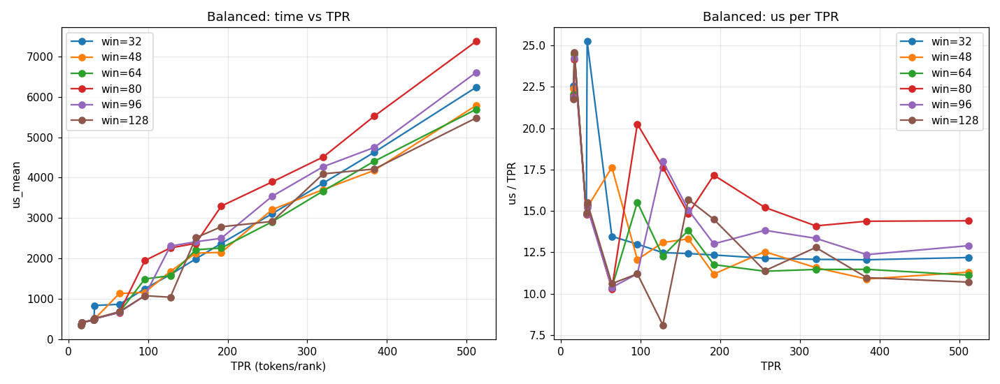

# 08 均衡场景窗口扫描测试

> 状态：实测记录。本文只陈述测得的数据与直接拟合结果，不作为最终修正系数的定论。

## 1. 测试目的

在均衡负载（scene=1）下，对候选窗口集合 {32, 48, 64, 80, 96, 128} 逐一固定，测量耗时随 TPR 的变化，
为 docs/06 的 auto window 成本模型提供数据。

## 2. 测试环境与方法

- 程序：`test/mybench`，`-s 1`（均衡场景），`-tprs` 指定每 rank tokens。
- 配置：R=32，topk=8，EPR=8，kNSlice=4（固定），merge 已去除（m=1），`max_tokens=512`。
- 窗口固定方式：临时 harness 开关 `MT_FORCE_WIN`（仅用于本测试，已还原，未提交）。
- 指标：`us_mean`（每个 case 的平均耗时，单位 µs）。
- TPR 取值：16、17、32、33、64、96、128、160、192、256、320、384、512（共 13 点）× 6 个窗口。

均衡场景下每个本地专家的行数近似为 TPR（R·TPR·topk/(R·EPR·...) 的均匀分布），因此每专家窗口数
`n = ceil(TPR / win)`，本地专家窗口总数 `W = EPR · n = 8n`。

## 3. 测试结果

### 3.1 数据表（us_mean，µs）

| win | 16 | 17 | 32 | 33 | 64 | 96 | 128 | 160 | 192 | 256 | 320 | 384 | 512 |
|---|---:|---:|---:|---:|---:|---:|---:|---:|---:|---:|---:|---:|---:|
| 32 | 361 | 416 | 473 | 833 | 862 | 1247 | 1598 | 1988 | 2369 | 3108 | 3864 | 4628 | 6239 |
| 48 | 358 | 416 | 474 | 502 | 1129 | 1158 | 1676 | 2130 | 2148 | 3210 | 3704 | 4180 | 5788 |
| 64 | 353 | 416 | 475 | 506 | 664 | 1490 | 1571 | 2213 | 2257 | 2908 | 3669 | 4406 | 5692 |
| 80 | 350 | 410 | 473 | 508 | 659 | 1945 | 2258 | 2372 | 3295 | 3895 | 4512 | 5522 | 7376 |
| 96 | 350 | 412 | 474 | 502 | 664 | 1075 | 2305 | 2410 | 2499 | 3541 | 4271 | 4747 | 6606 |
| 128 | 348 | 418 | 476 | 513 | 679 | 1075 | 1037 | 2511 | 2783 | 2915 | 4094 | 4212 | 5479 |

### 3.2 图表



左图：耗时随 TPR 的变化；右图：单位 TPR 耗时（us/TPR）。

## 4. 观察

1. **耗时随 TPR 近似线性增长**，每条曲线在大 TPR 区间基本单调。
2. **窗口数相同时结果不同**：例如 TPR=96 时，win=48（n=2，W=16）为 1158 µs，win=64（n=2，W=16）为 1490 µs，
   win=96（n=1，W=8）为 1075 µs，二者的 W 不同导致比较不能只看 W。
3. **不存在单一最优窗口**：在每个 TPR 下，最优窗口不同（如 TPR=64 时 win=80 最优 659 µs，
   TPR=96 时 win=96 与 128 最优 1075 µs，TPR=128 时 win=128 最优 1037 µs，TPR=192 时 win=48 最优 2148 µs）。
4. **噪声与离散性明显**：同一 win 在相邻 TPR 上出现非单调跳变（如 win=64 在 TPR=64→96 由 664 跳至 1490，
   win=80 由 659 跳至 1945）。这些跳变与窗口台阶（`n` 的整数跳变）及 32 个 block 的波次相关，需要在模型中显式建模。

5. **小 TPR 段（16–33）的台阶**：
   - TPR=16、17、32 时各 win 差异很小（348–418 µs，最大差约 20%）。这一区间每专家仅 1 个窗口（n=1），
     对 win ≥ TPR 的所有配置工作量相同，差异主要来自固定开销与噪声。
   - TPR=33 是明显的台阶：win=32 从 473 跳至 833 µs（n 由 1 变为 2），而 win=48/64/80/96/128 仅增加约 30 µs
     （n 仍为 1，因 33 ≤ win）。这说明 win=32 在 TPR>32 时的拆分代价远大于其他窗口。
   - 因此 TPR 在 33 附近，win=32 的选择明显不利，而 win ≥ 48 的配置在 TPR≤win 时几乎不受影响。

## 5. 线性拟合（每个窗口独立）

模型：`t = slope · W + intercept`，其中 `W = 8·ceil(TPR/win)`，对 4 个 TPR（64、128、256、512）拟合。

| win | slope (µs / 专家窗口) | intercept (µs) | R² | slope / win (µs/行) |
|---:|---:|---:|---:|---:|
| 32 | 48.10 | 65.5 | 1.000 | 1.50 |
| 48 | 64.54 | 110.8 | 1.000 | 1.34 |
| 64 | 88.45 | 54.9 | 0.999 | 1.38 |
| 80 | 135.29 | −241.1 | 0.993 | 1.69 |
| 96 | 144.51 | −189.3 | 0.989 | 1.51 |
| 128 | 192.54 | −553.0 | 0.982 | 1.50 |

注意：
- 拟合仅使用 TPR=64、128、256、512 四个点（小 TPR 段的数据未纳入拟合，因其 n=1 或台阶效应主导）
- 拟合仅使用 4 个 TPR 点，且 TPR=64 处存在台阶效应；R² 高不代表模型正确。
- intercept 为负（win=80/96/128），说明"每窗口线性成本"的形式在大窗口下不成立。
- 单位行成本在 1.34–1.69 µs/行之间，80 偏高，原因未知。

## 6. 局限

1. 只覆盖均衡场景。不均衡场景的行为（大专家与小专家并存）未检验。
2. 每个点只测一次（每 case 两次重放的均值），未报告方差；相邻 TPR 的非单调跳变说明噪声或台阶效应显著。
3. 没有 profiler 分项数据，无法确定耗时由权重读取、A 读取还是同步主导（按 L1 访存受限的既有结论，
   需用 profiler 验证，不能直接推断）。
4. 线性模型不能描述台阶与波次效应，修正系数需要以 `ceil(W·N/G)` 的波次形式重新拟合。

## 7. 对 auto window 的含义

- 均衡场景下不存在统一最优 win；选择规则必须依赖 TPR（即每专家行数）。
- 候选 {32, 48, 64, 80, 96, 128} 中，80 的单位成本与台阶表现均不理想，是否保留需由不均衡场景数据决定。
- 在拟合得到稳定的修正系数之前，不应将本表的线性系数直接写入设备端判据（与 docs/06 第 4 节一致）。

## 8. 复现

```
MT_FORCE_WIN=<win> TIMEOUT=900 ./scripts/run.sh mybench -s 1 -tprs 64,96,128,160,192,256,320,384,512
```

（`MT_FORCE_WIN` 为临时开关，需自行在 `test/mybench.cu` 中添加，本文测试后已还原。）

原始日志：`.agents/work/bal_w*.log`、`bal2_w*.log`（TPR=96/160/192/320/384）、`bal3_w*.log`（TPR=16/17/32/33）；汇总：`.agents/work/bal_all.txt`。
