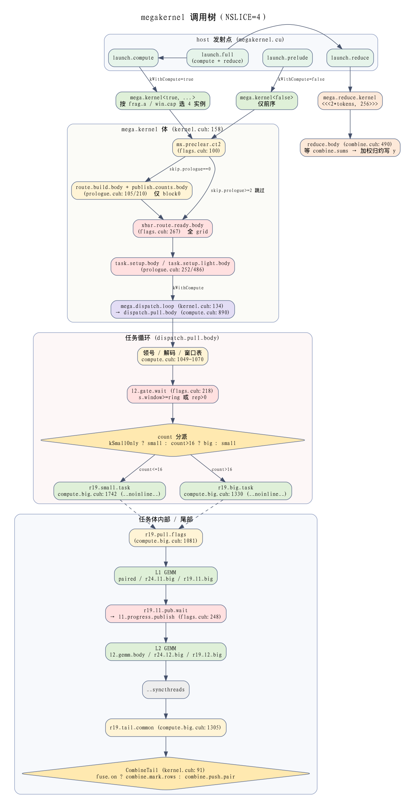
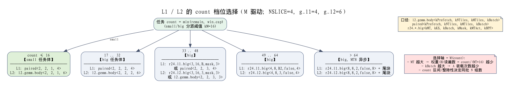

# 09 megakernel 调用树与参数分支

> 状态：基于当前代码（NSLICE=4，`KNSLICE_OVERRIDE` 默认 4）的静态梳理。
> 行号以仓库当前版本为准；未逐行核实的部分在 §7 标注。

## 1. 文件分层

```
megakernel.h / megakernel.cu   host 接口 + 全部 kernel 发射点
kernel.cuh                     __global__ 体：mega_kernel / mega_reduce_kernel / mega_empty_kernel
prologue.cuh                   ROUTE_BUILD / PUBLISH_COUNTS / TASK_SETUP
flags.cuh / flags_defs.cuh     跨 rank / 本地旗区与同步原语
compute.cuh                    任务循环 dispatch_pull_body、小/通用 GEMM 原语、l2_gemm_body
compute_big.cuh                r19_small_task / r19_big_task（任务体）及 r19/r24 大档位 GEMM
combine.cuh                    COMBINE 推送（combine_push_pair / combine_mark_rows）与 reduce_body
common.cuh                     场景常量、CM_* 宏默认值、计数器枚举
```

## 2. 总调用树



> 图源：`docs/figures/261010_09_31_megakernel_call_tree.png`。按仓库约定，本目录图只保留 PNG。
> 图中各节点的文件:行号与下文 §3–§5 的表一致。

## 3. 入口与模板实例化（megakernel.cu）

| 入口 | 发射的 kernel | 模板实参 | 触发条件 | 行 |
|---|---|---|---|---|
| `launch_prelude` | `mega_kernel<false>` | kWithCompute=false | 仅前序（ROUTE/PUBLISH/XBAR/TASK_SETUP） | :178 |
| `launch_compute` | `mega_kernel<true>` | kWithCompute=true | 计算链（DISPATCH→L1→L2→COMBINE） | :197 |
| `launch_reduce` | `mega_reduce_kernel` | — | 每次全链必经，grid=`2*tokens`，block=256 | :217 |
| `launch_empty` | `mega_empty_kernel` | — | 空基准 | :230 |
| `fill_weights_lane` | `fill_w_lane_kernel` | — | 权重填充工具 | :234 |

`launch_compute` 在 `MEGA_DEBUG=4` 时先发 `mxk_dbg_capture_kernel<<<1,1>>>`（仅 printf），默认关闭。

> `[OPT-KCAP-REMOVE]` 已去掉编译期 `kCap` 模板参：`launch_compute` 恒发射
> `mega_kernel<true>`（`mega_kernel<true,false,MegaPhase::Both>`），不再按 `win_cap`
> 选 48/64 实例；重档寄存器/栈改由 `r24_*_big` 的 `R19_GEMM_ATTR=__noinline__` 隔离。

## 4. 参数如何改变路径

### 4.1 编译期参数

| 参数 | 作用 | 取值与影响 |
|---|---|---|
| `kWithCompute` | 是否进入任务循环 | `false`：只跑前序；`true`：前序 + 计算链 + COMBINE |
| `kSmallOnly` | 编译期删除大 count 任务体 | **当前无任何实例化点**，属未使用模板分支（§6） |

> `[OPT-KCAP-REMOVE]` 原 `kCap` 编译期 count 上界模板参已删除（重档隔离改走
> `R19_GEMM_ATTR=__noinline__`，见 §3 注）。

> [FRAG-ALWAYS，2026-10-10] 原 `kFragCap` 模板参已删除：A/f2 的 4-line
> fragment 快路径**恒编译**（`if constexpr(kFragCap)` 的 true 分支为唯一路径），
> 运行期是否真走由 `frag_a`/`S.frag_all`/`S.afrag_ok` 决定（见 `compute.cuh`
> 的 `S.frag_all`）。代价：均衡场景也会编译该分支，可能带来寄存器/栈
> collateral（实测均衡 TPR256 +1.2%、TPR64 −3.8%，见提交信息）。

### 4.2 运行期参数

| 参数 | 来源 | 影响 |
|---|---|---|
| `skip_prologue` | `MegaArgs` | `0`：完整前序；`1`：复用前序，仅 `task_setup_light_body`；`≥2`：连 XBAR 也跳过（诊断） |
| `combine_rows_off` | host | `<0` 时 `CombineTail` 的上下文不填充，融合能力关闭，任务尾为空操作 |
| `ffn_hidden` | host | `S.afrag_ok`（单波单窗）决定 L1/L2 是否取 `ffn_hidden` 槽的 fragment |
| `rwk->ld.frag_a` / `frag2` | kernel 内部（`local_data`） | [FRAG-INT] 恒非空；`!S.afrag_ok` 时 `S.frag_all=true`，多窗口走 fragment，host 不再传入 |
| `count`（每窗口行数） | 任务解码 | 决定 small/big 分派（阈值 `kM=16`）及 big 内 L1/L2 的档位 |
| `g_l1 = (l1_n_total/l1_block_n)/nslice_eff` | 运行期几何 | NS=4 时 `g_l1=4`；决定 `%4 / %2` 分支 |
| `g_l2 = (l2_k_out/l1_block_n)/nslice_eff` | 运行期几何 | NS=4 时 `g_l2=6`；决定 `%6 / %4 / %3` 分支 |
| `KNSLICE_OVERRIDE`（`kNSlice`） | 编译期宏，`common.cuh:23` | 默认 4；改为 8 时 `g_l2=3`，需走 `g_l2==3` 单批分支（见 §5.4） |
| `MX_DBG_COUNT` | 编译期宏 | 默认 0；为 1 时 `MX_CTR_*` 生效，并在 `MegaArgs` 中加入 `exec_ctr/dbg_count` |
| `CM_L1_GATE` / `CM_L2_GATE` | `compute.cuh:131/136` 宏 | 默认 `warp<8 && count>0`，控制 L1/L2 是否在该 warp 执行 |
| `R29_COMBINE_FUSE` | 宏，默认 1 | 允许 L2 输出直接融合推送（`fuse.on`） |
| `R33_WARPPUSH` | 宏，默认 1 | 融合推送用 `combine_push_warp_cols`（compute_big.cuh:1041） |
| `CM_USE_BSM` / `CM_SMALL_BSM` | 宏，默认 0 | 关闭 B 的异步 shared-memory 路径 |
| `CM_MED_R24` | 宏，默认 1 | 33..48 档 L2 尝试 `r24_l2_big<3,...>` |

## 5. 任务循环内的分派

### 5.1 任务级分派（compute.cuh:1092-1104）

```
kSmallOnly ?              → r19_small_task
count > kM (16) ?         → r19_big_task
否则                      → r19_small_task
```

`32 / 48 / 64` 不是 `kM`，它们是 `r19_big_task` 内部的字面量阈值。

### 5.2 `r19_big_task` 的 L1 分支（compute_big.cuh:1358-1559）

以 `g_l1 = 4`（NS=4 时）为例：

| 序 | 条件 | 实例（PF, NT, MT, Batch） | 行 |
|---|---|---|---|
| 1 | `count≤32 && g_l1%4==0` | `paired<2,2,2,4>`（fbase 时 kUseFrag） | 1394-1426 |
| 2 | `count≤32 && g_l1%2==0 && g_l1≥2` | `paired<2,2,2,2>` | 1427-1434 |
| 3 | `count≤48 && g_l1%4==0` | fbase 且 `(k_in/32)%16==0` → `r24_l1_big<3,16,B,mask,3>`；否则 `paired<2,2,3,4>` | 1435-1480 |
| 4 | `count≤48 && g_l1%2==0 && g_l1≥2` | `paired<2,2,3,2>` | 1481-1487 |
| 5 | `48<count≤64 && fbase && count%64==0 && (k_in/32)%8==0` | `r24_l1_big<4,R24_KS,B2,false,4>` | 1444-1456 |
| 6 | `kAsyncL1`：fbase && count>64 && `(k_in/32)%8==0` && g_l1%2==0 | 整块 `r24_l1_big<8,8,2,false,8>`；尾块：`count-full≤16` → `<1,16,2,mask,1>`；`l1_act==5` → `<8,8,2,mask,5>`；否则 `<8,8,2,mask,8>` | 1458-1500 |
| 7 | 其余 | `r19_l1_big<4,2,4>` | 1501-1508 |

> `[OPT-KCAP-REMOVE]` 原序 6/7 的 `kCap48`/`kCap64` 分支已删除（无编译期裁档）。
> 本表前几行的 `paired` 实例为历史记录：生产已改用 `r19_l1_big`（配对等价），
> 当前档位与运行期 `win_cap` 选 `BPF` 以 `docs/12_L1函数族说明.md` §5 为准。

### 5.3 `r19_big_task` 的 L2 分支（compute_big.cuh:1607-1726）

以 `g_l2 = 6`（NS=4 时）为例：

| 序 | 条件 | 实例 | 行 |
|---|---|---|---|
| 1 | `count≤32 && g_l2%6==0` | `l2_gemm_body<2,2,2,6>` | 1607-1626 |
| 2 | `count≤32 && g_l2%3==0 && g_l2≥3` | `l2_gemm_body<2,2,2,3>`（NS=8 也走此分支） | 1627-1633 |
| 3 | `count≤48 && g_l2%6==0` | `f2 && (l1_k_out/32)%16==0` → `r24_l2_big<3,16,3,mask,3>`；否则 `l2_gemm_body<2,2,3,3>` | 1634-1666 |
| 4 | `48<count≤64 && f2 && count%64==0 && (l1_k_out/32)%8==0` | `r24_l2_big<4,R24_KS,3,false,4>` | 1614-1621 |
| 5 | `kAsyncL2`：f2 && count>64 && `(l1_k_out/32)%8==0` | 整块 `r24_l2_big<8,8,2,false,8>`（传 `&fuse`）+ 尾块同 L1 | 1622-1654 |
| 6 | 其余 | `r19_l2_big<4,1,3>` | 1655-1662 |

> `[OPT-KCAP-REMOVE]` 原序 5/6 的 `kCap48`/`kCap64` 分支已删除；`count≤48`/`≤64`
> 的兜底现统一走「其余」`r19_l2_big<4,…>`（对生产 `kCap=0` 行为不变）。

### 5.4 `r19_small_task` 的 L1/L2 分支（compute_big.cuh:1742-1845）

small 路径**不走 fragment，也不设置 `fuse.on`**，因此任务尾恒为 `combine_push_pair`。

- **L1**：`g_l1%4==0` → `paired<2,2,1,4>`（:1779）；否则 `paired<4,2,1,2>`（:1785）
- **L2**（当前代码顺序）：
  1. `g_l2%6==0` → `l2_gemm_body<2,2,1,6>`
  2. `g_l2%4==0` → `l2_gemm_body<2,2,1,4>`
  3. **`g_l2==3` → `l2_gemm_body<2,2,1,3>`（单批 3 组）**——NS=8 的正确路径
  4. `g_l2%3==0` → 两次 `l2_gemm_body<2,2,1,3>`（3+3 两批，`[O3]`）
  5. 其余 → `l2_gemm_body<4,2,1,2>`

> 第 3 条是 2026-10-10 为修复 NS=8 输出全零加入的（commit `0232ad8`）。
> 原因：`g_l2=3` 时 `[O3]` 的 `gb=1`，两批各不足 `kBatch=3` 组，组循环一次都不进。
> NS=4 下 `g_l2=6`，不触发该分支。

> 注：本表以 `l2_gemm_body<kPrefetch, kNTiles, kMTiles, kBatch>` 参数顺序书写（`compute.cuh:718`）。

### 5.5 L1/L2 变体为什么存在（M/N/K 与性能归因）

#### 5.5.1 文档结论

- **L1 与 L2 是两种 GEMM，必须分家**：N、K、epilogue 都不同（见下表），
  这是数学结构差异，与性能无关。
- **各自的内部变体以 M（`count`）为选择轴**，不是 N/K。N/K 只决定 kBatch、
  kNTiles（N）与 kPrefetch、k_iters（K），是把 L1、L2 各自定型，不作为档位选择。
- 变体**绝大多数是性能驱动**（减少 B/权重读遍数、平衡 A 重读、避开 M 空转、
  隔离寄存器/栈）；少数由**整除 / gate-up 配对**约束驱动（正确性）。

#### 5.5.2 M/N/K 映射

| 阶段 | M（分块行） | N（输出宽） | K（规约） | epilogue |
|---|---|---|---|---|
| L1 | `count`（运行期 1..win_cap） | `2*I = 4096`（gate+up） | `H = 6144` | SwiGLU + FP8 量化 |
| L2 | `count`（同上） | `H = 6144` | `I = 2048` | BF16 输出 |

#### 5.5.3 count 档位选择图



> 图源：`docs/figures/261010_09_31_l1l2_count_tiers.png`（NSLICE=4，`g_l1=4`，`g_l2=6`）。

#### 5.5.4 每条轴的目的（性能 vs 约束）

**性能驱动（多数）：**

| 轴 | 机制 | 效果（来源） |
|---|---|---|
| M 档位 MT | B（权重）在 kMT 个 M tile 间共享，权重读遍数 = `count/(MT*16)` | TPR=128 权重读 8 遍→2 遍，2453→1406µs（`compute_big.cuh:4-9`） |
| MT 随 count 增大 | 大档升 MT8 | TPR=256 L1 909→713µs（`compute_big.cuh:42-52`） |
| kBatch（N 组批） | kBatch 个 N 组共享一份 A，A 装载次数 = 1/kBatch | `compute.cuh:719` |
| A fragment | fbase/f2 走 4-line 连续装载，否则 16-line 散射 | 消除 L2 straggler 130→16µs（`compute_big.cuh:27-40`） |
| task 隔离 | small/big 两个 `__noinline__`，寄存器不共享 | 保护 count=16 热路径（`compute_big.cuh:11-16`） |
| GEMM 属性隔离 | `r24_*_big` 加 `R19_GEMM_ATTR=__noinline__`，重档独立寄存器/栈 | 替代原 `kCap` 编译期裁档（`[OPT-KCAP-REMOVE]`） |
| bsm | B 走 smem 异步 | 实测中性/略负（`perf.md:330`），默认关 |

**约束驱动（少数，正确性）：**

| 约束 | 说明 | 位置 |
|---|---|---|
| `g_l1%4` / `g_l2%6` 整除 | 组循环要求 `n_group_count` 为 kBatch 整数倍 | `compute.cuh:317` |
| gate/up 配对 | N=2I 须按 256 列成对，kBatch 取偶数 | `compute.cuh:53-55` |
| `g_l2%3==0` 的 3+3 两批 | 本场景 g_l2=6 整除；NS=8 时 g_l2=3 会丢组 | `compute_big.cuh:1830`，见 §5.4 |
| `kAsync` 的 count>64 门槛 | ≤64 时 async 无权重收益且更慢 | `compute_big.cuh:66` |

## 6. 注意与死代码

| 项目 | 状态 | 依据 |
|---|---|---|
| `kSmallOnly = true` | **无实例化点**，模板分支不会生成 | 全仓库仅 `compute.cuh:884/1092` 出现 |
| `NoTaskTail`（`mega_kernel` 的参数） | 被 `kernel.cuh:249` 的局部 `CombineTail tail` 遮蔽，运行期不执行 | kernel.cuh:249 |
| `kFragCap` | **已删除**（[FRAG-ALWAYS]）：fragment 分支恒编译 | kernel.cuh:132、compute_big.cuh:1329 |
| `subset_barrier_n` | 无调用方 | flags.cuh:118 |
| `subset_barrier_phase` | 生产路径不执行（`tid_base=0` 退化为 `__syncthreads`） | prologue.cuh:276；kernel.cuh:232 |
| `slice_gate_wait` | 所有可见调用方 `gate=nullptr`，不执行 | compute.cuh:358/413 |
| `l1_prog_gate_wait` | 生产不可达（`compute.cuh:1074` 传 `l1_prog_idx=-1`） | flags.cuh:241 |
| L1→L2 依赖 | 实际由内联 wait-all 完成 | compute_big.cuh:1282-1296 |

## 7. 未核实项

- `r19_l1_tile` / `r19_l2_tile` 内部实现（compute_big.cuh:355 / 752）未逐行核对。
- `R19_LDB`、`R21_LDA` 宏的 `#if` 条件未逐行核对。
- `slice_gate_wait` 外层 `gate_on` 的精确结构未核对（仅知其不执行）。
- `r24_l2_big` 尾部 `kBatch=1` 余量段（约 1053-1060 之后）未逐行核对。
- `ring`、`l1_n_total` 等运行期值来自 host，本文以 NS=4、TPR=16 的常见值为例，未逐一验证取值。
- `count ≥ 1` 由窗口划分保证，为推断，未逐行验证。

## 8. 复现方法

```bash
# 查看入口的模板实例
rg -n "mega_kernel<" src/megakernel.cu
# 查看任务分派
sed -n 1088,1106p src/compute.cuh
# 查看 small 路径 L2 分支
sed -n 1797,1845p src/compute_big.cuh
```

## 9. 插图约定

本目录（`docs/figures/`）**只保留 PNG**，不使用 Mermaid / SVG / 图片源码。
当前两张图均由 graphviz `dot` 生成（中文需 CJK 字体，本机用 `HeiTi.ttf`）：

```bash
# 生成示例（图源 .dot 不入库；如需重建，按本文各表重建节点后渲染）
dot -Tpng call_tree.dot  -o docs/figures/<时间标签>_megakernel_call_tree.png
dot -Tpng l1l2_tiers.dot -o docs/figures/<时间标签>_l1l2_count_tiers.png
```
