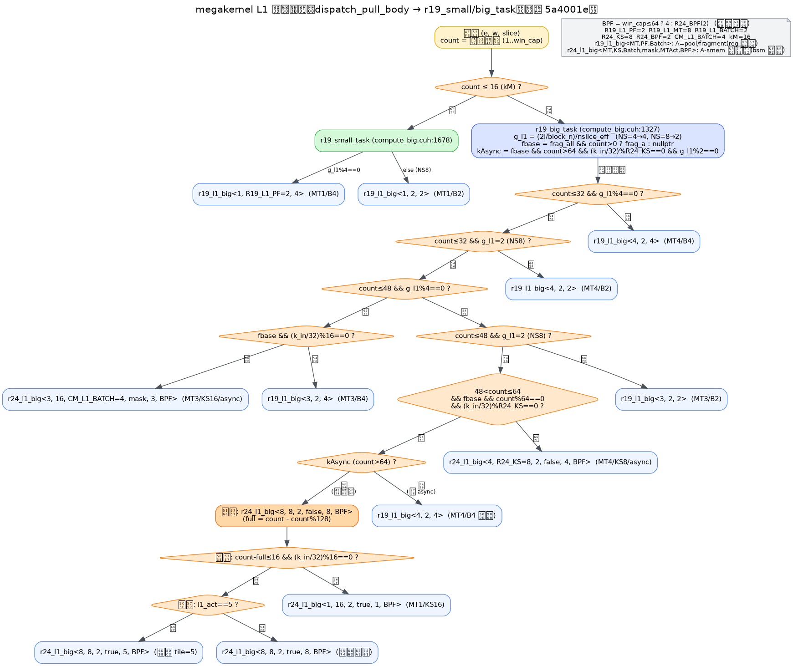

# 13 L1 选核逻辑（决策树 + 档位表）

> 目的：一图说清 megakernel 任务循环内**如何为每个窗口任务选自 L1 GEMM 变体**。
> 对齐提交：`5a4001e`（`[261011_11_28]` 清除编译期 `kCap`）。函数族细节见
> `docs/12_L1函数族说明.md`；调用树见 `docs/09_megakernel调用树与参数分支.md`。
> 口径：H=6144、I=2048、topk=8、EPR=8、`block_n=256`、`kComputeWarps=8`、
> `kNTilesPerWarp=2`、`kM=16`；`kNSlice` 默认 4（NS=8 为 `g_l1=2` 几何）。

## 1. 决策树



## 2. 两级入口

`dispatch_pull_body`（`compute.cuh:695`）在每个任务上按 **`count`（窗口实际行数）** 分流：

| 条件 | 任务体 | 说明 |
|---|---|---|
| `count ≤ kM`(16) | `r19_small_task`（`compute_big.cuh:1678`） | 热路径，独立 `__noinline__` |
| `count > kM` | `r19_big_task`（`compute_big.cuh:1327`） | M 档位，独立 `__noinline__` |

两者寄存器/栈互不污染（`R19_SMALL_ATTR`/`R19_BIG_ATTR`）。

## 3. 分派用的运行期量

| 量 | 定义 | 取值 |
|---|---|---|
| `g_l1` | `(l1_n_total/l1_block_n)/nslice_eff` = `(2I/256)/nslice_eff` | NS=4→**4**；NS=8→**2** |
| `fbase` | `frag_all && count>0 ? S.frag_a[数据槽] : nullptr` | A 走 fragment（4-line）否则行主序 pool |
| `kAsync` | `fbase && count>64 && (k_in/32)%R24_KS==0 && g_l1%2==0` | 仅大 M 触发 |
| `BPF` | `win_cap≤64 ? 4 : R24_BPF(2)` | r24 档的 B 预取深度（运行期在调用点选） |
| `full` | `count - count%(R19_L1_MT*kM)` | kAsync 整块行数（128 的倍数） |
| `l1_act` | `ceil((count-full)/16)` | kAsync 尾块活跃 tile 数 |

## 4. 档位表（按判定顺序，`compute_big.cuh` L1 段）

| 序 | 条件 | L1 变体 | A 通路 |
|---|---|---|---|
| — | `count≤16 && g_l1%4==0`（small） | `r19_l1_big<1,2,4>` | pool/frag |
| — | `count≤16` 其他（NS=8） | `r19_l1_big<1,2,2>` | pool/frag |
| ① | `count≤32 && g_l1%4==0`（17..32） | `r19_l1_big<2,1,4>` [L1TUNE-B] | pool/frag |
| ② | `count≤32 && g_l1=2`（NS=8） | `r19_l1_big<4,2,2>` | pool/frag |
| ③ | `count≤48 && g_l1%4==0 && fbase && (k_in/32)%16==0` | `r24_l1_big<3,16,CM_L1_BATCH,true,3,BPF>` | A-smem |
| ③' | ③ 条件不满足（无 fbase/几何不符） | `r19_l1_big<3,2,4>` | pool/frag |
| ④ | `count≤48 && g_l1=2`（NS=8） | `r19_l1_big<3,2,2>` | pool/frag |
| ⑤ | `48<count≤64 && fbase && (k_in/32)%R24_KS==0` [L1TUNE-D] | 整块(64)：`r24_l1_big<4,R24_KS,2,false,4,BPF>`；49..63：`<...,true,4,BPF>`（尾块掩码） | A-smem |
| ⑥a | `kAsync` 且 `full>0` | `r24_l1_big<8,R24_KS,2,false,8,BPF>`（全块） | A-smem |
| ⑥b | `kAsync` 尾块 `count-full≤16 && (k_in/32)%16==0` | `r24_l1_big<1,16,2,true,1,BPF>` | A-smem |
| ⑥c | `kAsync` 尾块 `l1_act==5` | `r24_l1_big<8,R24_KS,2,true,5,BPF>` | A-smem |
| ⑥d | `kAsync` 尾块 其他 | `r24_l1_big<8,R24_KS,2,true,8,BPF>` | A-smem |
| ⑦ | 其余（非 async 几何） | `r19_l1_big<4,2,4>` | pool/frag |

> 判定**严格按序**：前面的条件命中即返回，后序不再评估。①/② 与 ③/④ 的差别仅在
> `count` 与 `g_l1`；生产默认 NS=4（`g_l1=4`）只走 ①③⑤⑥⑦。
> [L1TUNE-B/D]（提交 261011_13_xx）：① 由 MT4/PF2 改 MT2/PF1（17..32 −22%）；
> ⑤ 由「仅 count=64」扩到 49..64，49..63 用尾块掩码（−22%）。见 `docs/16`。
> 上方决策树图（`261011_11_30`）为改动前快照。

## 5. 变体签名与常量

- `r19_l1_big<kMT, kPF, kBatch>`：A/B 走寄存器预取环；`kMT` 个 M-tile 共享 B 一遍，
  权重遍数 `= ceil(count/(kMT*16))`。
- `r24_l1_big<kMT, kKS, kBatch, kMask, kMTAct, kBPF>`：A 走 A-smem 双缓冲（bsm 异步），
  B 直装；`kMask`=尾块掩码、`kMTAct`=活跃 M-tile 数（编译期裁剪）。

| 常量 | 值 | 常量 | 值 |
|---|---:|---|---:|
| `R19_L1_PF` | 2 | `R19_L1_MT` | 8 |
| `R19_L1_BATCH` | 2 | `R24_KS` | 8 |
| `R24_BPF` | 2 | `CM_L1_BATCH` | 4 |
| `kM` | 16 | `kComputeWarps` | 8 |

## 6. 关键点

1. **`kAsync` 门槛 `count>64`**：≤64 时 async 无权重收益且多一 stage 同步 → 保持非 async 回退。
2. **权重遍数**：`r19`/`r24` 每 `kMT*16` 行读 B 一遍；大 M 升 MT8 使遍数减半。
3. **`BPF` 运行期选**：`win_cap≤64`（tk/长尾）用 4，均衡大档用 2；由 `[OPT-KCAP-REMOVE]`
   取代原编译期 `kCap` 裁档。
4. **重档隔离**：`r24_l1_big` 加 `R19_GEMM_ATTR=__noinline__`，独立寄存器/栈，
   避免拖慢同任务体内的小/中档路径。
5. **fragment 优先**：`fbase` 非空走 4-line fragment，否则 16-line 行主序 → 实测恒更优。

## 7. 复现

```bash
# 决策树图源渲染（图源 .dot 不入库）
dot -Tpng <l1_select.dot> -o docs/figures/<时间标签>_l1_select.png
# 查看 L1 分支
sed -n '1354,1510p' src/compute_big.cuh
# 查看任务级分派
sed -n '908,922p' src/compute.cuh
```
