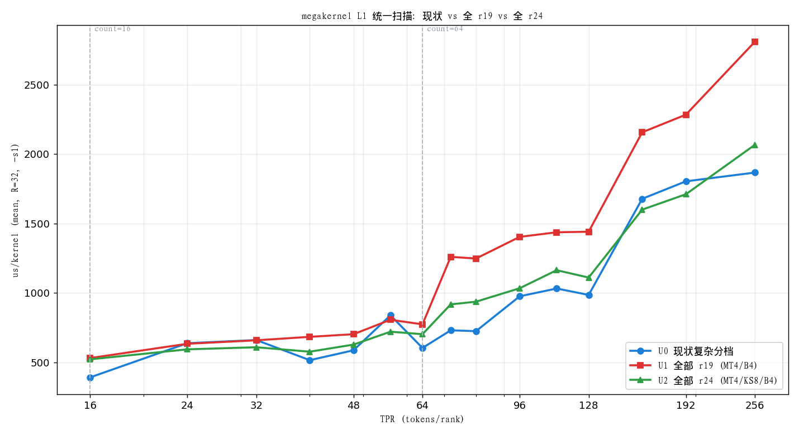

# 14 L1 统一实验（全 r19 / 全 r24）+ kernel 使用场景重规划

> 实验分支：`agent/l1sweep/uniform`（基于 `5a4001e`）。目的：去掉 L1 复杂分档，
> 分别强制**全部走 r19** 与**全部走 r24**，扫 `-s 1`（均衡）TPR，定位性能跳转/交叉点，
> 据此重规划 kernel 使用场景。
> 口径：`scripts/run.sh mybench -R 32 -s 1 -nodes 3 -replays 1`（us_mean，跨 rank）。
> 正确性：全 r24 变体 `check --smoke` **PASS**（8 用例，n=24576 数值校验全 PASS）。
> 注：`CM_L1_UNIFORM` / `CM_L1_R19_*` / `CM_L1_R24_*` 为**实验专用开关**，仅存在于
> `agent/l1sweep/uniform` 分支；main 只并入由本实验导出的 B/D 两处改动（见 docs/16 §5）。

## 1. 方法与开关

新增编译期开关 `CM_L1_UNIFORM`（`src/compute_big.cuh`，仅作用于 L1 段，**small/big 两任务体统一**）：

| 值 | L1 路径 |
|---|---|
| 0 | 现状复杂分档（baseline） |
| 1 | 全部 `r19_l1_big<4, R19_L1_PF, 4>`（MT4/B4，行主序或 fragment） |
| 2 | 全部 `r24_l1_big<4, R24_KS, CM_L1_BATCH, true, 4, R24_BPF>`（MT4/KS8/B4，A-smem） |

> L2 段**保持现状**（以隔离 L1 变量）。U1/U2 的 .so 明显更小（1.4MB vs 1.9MB），
> 因仅剩单一 L1 实例。

## 2. 结果（us_mean，R=32，-s1）

| TPR | U0 现状 | U1 全 r19 | U2 全 r24 | 最优 |
|---:|---:|---:|---:|---|
| 16 | **391** | 530 | 521 | U0 |
| 24 | 637 | 633 | **593** | U2 |
| 32 | 660 | 658 | **608** | U2 |
| 40 | **515** | 683 | 576 | U0 |
| 48 | **586** | 702 | 627 | U0 |
| 56 | 838 | 806 | **720** | U2 |
| 64 | **603** | 773 | 702 | U0 |
| 72 | **730** | 1259 | 917 | U0 |
| 80 | **724** | 1247 | 936 | U0 |
| 96 | **975** | 1403 | 1033 | U0 |
| 112 | **1031** | 1436 | 1163 | U0 |
| 128 | **985** | 1440 | 1110 | U0 |
| 160 | 1677 | 2156 | **1599** | U2 |
| 192 | 1803 | 2283 | **1710** | U2 |
| 256 | **1866** | 2808 | 2066 | U0 |

## 3. 跳转 / 交叉点

1. **count=16→17**：`MT1`→`MT4` 的 M 空转台阶。U0 用 small 档 `r19_l1_big<1>`（391），
   U1/U2 强制 MT4 → **+33%**（521/530）。→ **≤16 必须保留 MT1 小档**。
2. **count≈24**：`r24` 开始优于 `r19`（此前相当）。U2 从 TPR24 起全程 ≥ U1，
   且 r24 把大档权重/A 流量摊薄，故 **r24 是更优的单 L1 核**。
3. **count=64→65**：进入 L2 async/MT8 区间，三条曲线都出现台阶（本实验 L2 未变，
   台阶来自 L2）。U1 台阶更陡（r19 L1 无 A-smem，大 count 下 A 重复读）。
4. **count≈200**：`MT4(r24)` 与 `MT8 async` 交叉。160/192 U2（MT4）优于 U0（MT8 async），
   256 U0 反超。→ **MT8 async 的收益要到 count≳224 才稳定体现**（与 docs/12 §7 存疑一致）。
5. **r19 完全不适合大 count**：TPR256 2808 vs r24 2066／现状 1866（r19 无 A-smem、
   权重/A 重复读）。

## 4. kernel 使用场景重规划（建议）

现状分档（① ~ ⑦，见 `docs/13`）在低 count 与超大 count 上确有收益，但中段偏碎。
按本实验数据，建议收敛为 **3 区**：

| 区 | count | L1 | 依据 |
|---|---|---|---|
| A | ≤16 | `r19_l1_big<1, 2, 4>`（MT1） | U0 391 vs 统一 521，MT1 必留 |
| B | 17..64 | `r24_l1_big<4, KS8, B2, kMask, 4, BPF>` | r24 全面胜 r19；B2 优于 B4（64 档 603 vs 702）；33..48 可保留 `r24<3,16,B4>` 专档（515 vs 576） |
| C | >64 | `r24_l1_big<8, KS8, B2, kMask, MTAct, BPF>` 两段式 | 256：1866 vs MT4 2066；160/192 可试验倒退用 MT4 |

- **删除** r19 的 MT3/MT4 中档与 `r19_l1_big<4,2,4>` 兜底（仅保留无 fbase 时的正确性回退）。
- **保留** `kAsync` 的「全块 + 尾块」两段式与 `MTAct` 裁剪（C 区收益来源）。
- **B 区 kBatch 用 2**（非现状的 CM_L1_BATCH=4），64 档快 ~14%（603 vs 702）。
- C 区在 count∈(128,224) 可 A/B 测试 MT4 与 MT8-async（本实验提示交替前沿）。

## 5. 局限

- 仅统一了 **L1**；L2 保持现状，故 65 附近台阶含 L2 成分，不能全部归因 L1。
- `-replays 1`、`nodes 3`，单次测量，±5% 噪声；结论用于**相对趋势**而非绝对标定。
- U2 的 r24 统一档要求 `g_l1 % kBatch==0` 且 `(k_in/32)%R24_KS==0`；本题几何满足，
  一般几何仍需回退路径。
- 下一步：对 L2 做同样统一实验；把 A/B/C 三区方案做端到端 A/B 验证（docs/12 §8 教训）。
