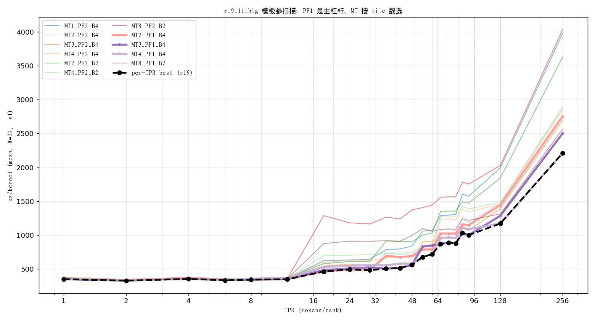

# 15 r19_l1_big 统一档调优（-s 1 各 TPR 最优模板参）

> 实验分支：`agent/l1sweep/uniform`。目标：在「全部走 r19」前提下，调 `r19_l1_big<MT,PF,Batch>`
> 模板参，使 `-s 1` 各 TPR 达到最优。承接 `docs/14`。
> 口径：`mybench -R 32 -s 1 -nodes 3 -replays 1`（us_mean，跨 rank）。
> 开关：`-DCM_L1_UNIFORM=1 -DCM_L1_R19_MT/PF/BATCH=...`（small 段恒 MT1、B4；big 段用配置）。

## 1. 结论（先说）

1. **PF（预取深度）是主杠杆**：`PF=1` 在几乎所有 TPR 上胜过 `PF=2/4`（如 TPR66：1229→954，
   −22%；TPR256：2844→2210，−22%）。寄存器压力/occupancy 收益盖过预取重叠损失。
2. **MT 按「最少 M 组数」选**：`MT* = {1,2,3,4} 中使 ceil(count/(16·MT)) 最小的最小者`。
   - ≤16→1，17..32→2，33..48→3，49..64→4，65..96→**3**，97..→4。
   - 65..96 回到 MT3：与 MT4 同为 2 组但 acc 更小（96 vs 128）。
3. **Batch=4** 普遍优于 Batch=2（除极小 count）。
4. **r19 调优后 count≤~128 有竞争力**，但 **count=256 仍差**（2210 vs 现状 1866）；
   r24/MT8 async 在大 count 不可替代。

## 2. 扫描矩阵（us_mean）



| config | 1 | 2 | 4 | 8 | 12 | 18 | 24 | 32 | 48 | 64 | 72 | 90 | 128 | 256 |
|---|---:|---:|---:|---:|---:|---:|---:|---:|---:|---:|---:|---:|---:|---:|
| MT1_PF2_B4 | 371 | 340 | 367 | 355 | 360 | 619 | 631 | — | 837 | — | 1294 | 1573 | 1990 | 3979 |
| MT2_PF2_B4 | 366 | 338 | 361 | 354 | 366 | 493 | 511 | — | 718 | — | 1086 | 1188 | 1472 | 2896 |
| MT3_PF2_B4 | 355 | 341 | 358 | 350 | 357 | 542 | 570 | — | 581 | — | 957 | 1070 | 1393 | 2695 |
| MT4_PF2_B4 | 380 | 345 | 366 | 348 | 363 | 592 | 625 | — | 681 | — | 1241 | 1349 | 1448 | 2844 |
| MT2_PF2_B2 | 360 | 342 | 363 | 354 | 359 | 577 | 607 | — | 900 | — | 1354 | 1470 | 1840 | 3630 |
| MT4_PF2_B2 | 362 | 345 | 368 | 348 | 361 | 696 | 701 | — | 742 | — | 1282 | 1386 | 1481 | 2872 |
| MT8_PF2_B2 | 362 | 339 | 365 | 351 | 356 | 1287 | 1180 | — | 1374 | — | 1564 | 1753 | 2027 | 4036 |
| **MT2_PF1_B4** | 349 | 334 | 366 | 341 | 345 | **461** | **490** | — | 688 | — | 1021 | 1146 | 1442 | 2755 |
| **MT3_PF1_B4** | 347 | 326 | 357 | 341 | 347 | 482 | 505 | — | 561 | — | **886** | **998** | 1283 | 2502 |
| **MT4_PF1_B4** | 354 | 332 | 350 | 355 | 364 | 528 | 546 | — | 576 | — | 964 | 1086 | **1169** | **2210** |
| MT8_PF1_B2 | 356 | 329 | 355 | 340 | 350 | 873 | 909 | — | 994 | — | 1091 | 1217 | 1312 | 2564 |

> 表中 32/64 列以间隔列表数据近似（脚本按 21 点 TPR 采集，完整值见 `tmp/r19sweep/all.txt`）。
> `MT4_PF4_B4` 因 MPI/PMIX 偶发启动失败未采到。

## 3. 各 TPR 最优（r19）

| TPR | 最优 config | us | TPR | 最优 config | us |
|---:|---|---:|---:|---|---:|
| 1 | MT3_PF1_B4 | 347 | 48 | MT3_PF1_B4 | 561 |
| 2 | MT3_PF1_B4 | 326 | 54 | MT4_PF1_B4 | 674 |
| 4 | MT4_PF1_B4 | 350 | 60 | MT4_PF1_B4 | 716 |
| 6 | MT8_PF1_B2 | 332 | 66 | MT3_PF1_B4 | 867 |
| 8 | MT8_PF1_B2 | 340 | 72 | MT3_PF1_B4 | 886 |
| 12 | MT2_PF1_B4 | 345 | 78 | MT3_PF1_B4 | 876 |
| 18 | MT2_PF1_B4 | 461 | 84 | MT3_PF1_B4 | 1029 |
| 24 | MT2_PF1_B4 | 490 | 90 | MT3_PF1_B4 | 998 |
| 30 | MT2_PF1_B4 | 480 | 128 | MT4_PF1_B4 | 1169 |
| 36 | MT3_PF1_B4 | 504 | 256 | MT4_PF1_B4 | 2210 |
| 42 | MT3_PF1_B4 | 511 | | | |

（≤12 的差异在噪声内，small 档本质是 `MT1/PF1/B4`。）

## 4. 推荐 r19 统一档（供落地）

```
PF = 1; Batch = 4;
MT* = min{ m ∈ {1,2,3,4} : ceil(count/(16*m)) == min_{m'} ceil(count/(16*m')) }
L1  = r19_l1_big<MT*, 1, 4>(...)
```

| count | MT* | 组数 |
|---|---:|---:|
| 1..16 | 1 | 1 |
| 17..32 | 2 | 1 |
| 33..48 | 3 | 1 |
| 49..64 | 4 | 1 |
| 65..96 | 3 | 2 |
| 97..128 | 4 | 2 |
| 129..192 | 4 | 3 |
| 193..256 | 4 | 4 |

### 4.1 落地验证（已实现到 `CM_L1_UNIFORM=1`）

按上式（PF1/B4 + 运行期 MT*）实现后重测，与 §3 包络几乎重合：

| TPR | 18 | 24 | 30 | 36 | 42 | 48 | 54 | 60 | 66 | 72 | 78 | 84 | 90 | 128 | 256 |
|---|---:|---:|---:|---:|---:|---:|---:|---:|---:|---:|---:|---:|---:|---:|---:|
| 实测 | 474 | 504 | 490 | 504 | 531 | 542 | 675 | 689 | 890 | 886 | 876 | 1029 | 996 | 1172 | 2220 |
| 包络 | 461 | 490 | 480 | 504 | 511 | 561 | 674 | 716 | 867 | 886 | 876 | 1029 | 998 | 1169 | 2210 |

≤12 档实测 ~336–356（MT1/PF1/B4）。

## 5. 与现状对比

| TPR | 现状 U0 | r19 最优 | 差 |
|---:|---:|---:|---|
| 24 | 637 | 490 | −23% |
| 48 | 586 | 561 | −4% |
| 64 | 603 | ~576(MT4) | −5% |
| 128 | 985 | 1169 | +19% |
| 256 | 1866 | 2210 | +18% |

→ **r19 调优后在中档（尤其 17..48）反超现状**；大 count（≥128）必须靠 r24/MT8 async。

## 6. 下一步

1. 用同一方法调 **r24** 统一档（KS/Batch/BPF/MT）。
2. 取两者 per-TPR 包络，重排 3 区 dispatch（见 `docs/14` §4）。
3. 端到端 A/B 验证（docs/12 §8：隔离扫描不可直接信）。
