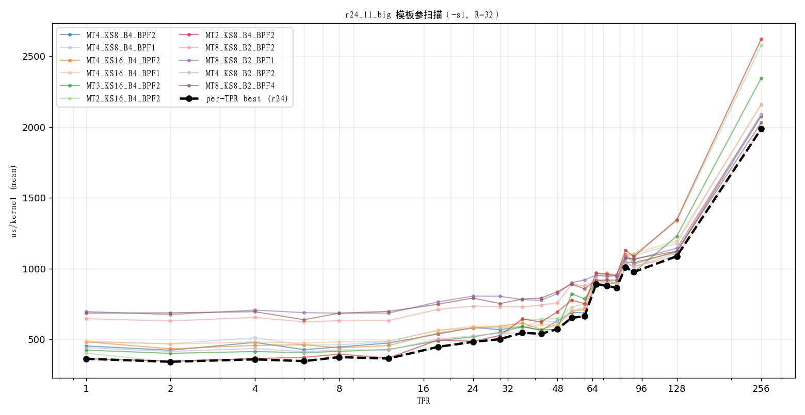
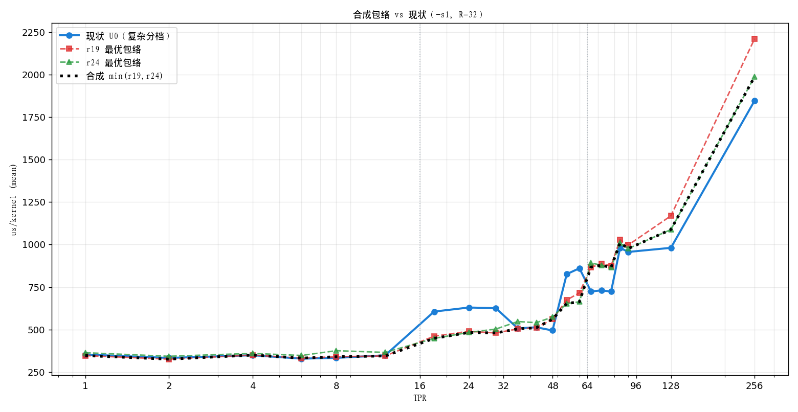
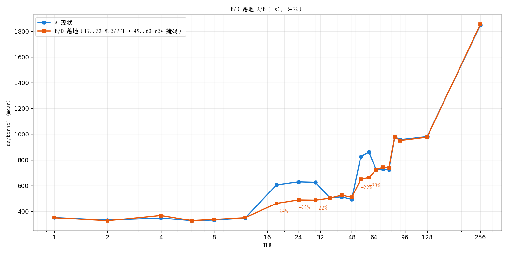

# 16 r24 统一档调优 + 合成包络 + dispatch 重规划

> 实验分支：`agent/l1sweep/uniform`。承接 `docs/14`（统一实验）、`docs/15`（r19 调优）。
> 口径：`mybench -R 32 -s 1 -nodes 3 -replays 1`（us_mean）。r24 参数化开关
> `-DCM_L1_UNIFORM=2 -DCM_L1_R24_MT/KS/BATCH/BPF=...`（kMask 恒 true、MTAct=MT）。

## 1. r24 模板参扫描（us_mean）

约束：`MT*KS ≤ 64`（A-smem 64KB）、`Batch*MT ≤ 16`（acc≤128）、`MT*KS % 16 == 0`
（`r24_issue_a` 的 512 线程切片整除，故 `MT3/KS8` 不可用）。Batch 须整除 `g_l1=4`。

关键结果（部分 TPR）：

| config | 18 | 24 | 30 | 48 | 60 | 66 | 128 | 256 |
|---|---:|---:|---:|---:|---:|---:|---:|---:|
| MT2_KS16_B4_BPF2 | **448** | **483** | **503** | 647 | 750 | 959 | 1335 | 2575 |
| MT4_KS8_B4_BPF2 | 539 | 585 | 569 | 632 | 688 | **892** | 1117 | 2076 |
| MT4_KS8_B2_BPF2 | 504 | 526 | 544 | 577 | 663 | 931 | 1109 | 2090 |
| MT3_KS16_B4_BPF2 | 491 | 519 | 551 | 574 | 788 | 904 | 1230 | 2345 |
| MT8_KS8_B2_BPF2 | 713 | 736 | 732 | 759 | 881 | 915 | **1088** | **1987** |

- 小 count（≤32）：`MT2/KS16/B4` 最好。
- 中 count（33..64）：`MT4/KS8/B2` 与 `MT3/KS16/B4` 互有胜负。
- 大 count（≥96）：`MT8/KS8/B2` 明确最好（128：1088，256：1987）。
- **BPF：r24 上 BPF2 普遍优于 1/4**（与 r19 的 PF1 相反）。

## 2. 合成包络（r19 最优 ∪ r24 最优）vs 现状

| TPR | 现状 U0 | r19 最优 | r24 最优 | 合成 | 合成−U0 |
|---:|---:|---:|---:|---:|---:|
| 18 | 606 | 461 | **448** | 448 | **−26%** |
| 24 | 630 | 490 | **483** | 483 | **−23%** |
| 30 | 626 | **480** | 503 | 480 | **−23%** |
| 36 | 507 | **504** | 547 | 504 | −1% |
| 42 | 513 | **511** | 541 | 511 | 0% |
| 48 | **495** | 561 | 574 | 561 | +13% |
| 54 | 826 | 674 | **653** | 653 | **−21%** |
| 60 | 861 | 716 | **663** | 663 | **−23%** |
| 66 | **724** | 867 | 892 | 867 | +20% |
| 72 | **730** | 886 | 878 | 878 | +20% |
| 90 | **957** | 998 | 977 | 977 | +2% |
| 128 | **981** | 1169 | 1088 | 1088 | +11% |
| 256 | **1846** | 2210 | 1987 | 1987 | +8% |

## 3. 结论

1. **现状复杂分档在大 count 是对的**：`count>64` 的 **r24 MT8 async 两段式（全块无掩码 + 尾块掩码）**
   比任何「统一 + 常掩码」都快（66：724 vs 867；128：981 vs 1088；256：1846 vs 1987）。
   故 **不能**把所有 count 统一到带掩码的单一 r24。
2. **但中段现状确实次优**，两处可见大幅收益：
   - **17..32 档**：现状 `r19_l1_big<4,2,4>`（MT4/PF2）→ 应为 `r19_l1_big<2,1,4>`
     （24：630→483，**−23%**）。
   - **49..63 档**：现状因 `count%64!=0` 掉进 r19 慢回退（54：826）→ 可用带掩码
     `r24_l1_big<4,KS8,B2,true,4,2>` 覆盖（54：653，**−21%**）。
3. r19 调优后在 17..48 有竞争力；r24 在 ≥96 反超；二者包络互补。

## 4. 重规划（建议 dispatch，比现状更简且更快）

| 区 | count | L1 | 变化 |
|---|---|---|---|
| A | ≤16 | `r19_l1_big<1, 1, 4>` | small（PF2→1） |
| B | 17..32 | `r19_l1_big<2, 1, 4>` | **MT4/PF2 → MT2/PF1（−23%）** |
| C | 33..48 | `r19_l1_big<3, 1, 4>`（或 `r24<3,16,B4>`） | MT3/PF2 → PF1 |
| D | 49..64 | `r24_l1_big<4, KS8, 2, true, 4, 2>` | **覆盖 49..63（−21%）** |
| E | >64 | `r24_l1_big<8, KS8, 2>` 两段式（全块无掩码 + 尾块 MT1/掩码） | 保持现状 |

- 删除 `g_l1=2`（NS=8）的并行小档与 r19 MT4 中档；B/C 用 MT 规则（最少组数）。
- E 保持现状（async 两段式 + `MTAct`/尾块裁剪），这是大 count 的收益来源。

## 5. B/D 落地 A/B（已实现）

把 §3.2 的 B（17..32→MT2/PF1）与 D（49..63 用 r24 掩码）落回**现状 dispatch**
（`CM_L1_UNIFORM=0`），同网格 A/B（`-s1, R=32, -nodes 3 -replays 1`）：

| TPR | A 现状 | B/D | Δ |
|---:|---:|---:|---:|
| 18 | 606 | 462 | **−24%** |
| 24 | 630 | 490 | **−22%** |
| 30 | 626 | 488 | **−22%** |
| 54 | 826 | 648 | **−22%** |
| 60 | 861 | 663 | **−23%** |
| 36/42/48 | 507/513/495 | 503/526/511 | ±3%（噪声） |
| 66/90/128/256 | 724/957/981/1846 | 725/951/976/1853 | ~0 |

- **命中预测**：中段两处 −22~24%，其余无回退。
- **正确性**：`check --smoke` **PASS**（8 用例，含 TPR=16/24/32/128 与 graph×50）。

## 6. 下一步

1. 把 B/D 两处改动落回现状 dispatch，做**端到端 A/B**（docs/12 §8）。
2. 再评估是否值得整并 NS=8 分支。
3. 提交实验（开关 + docs/14~16 + 图）。
