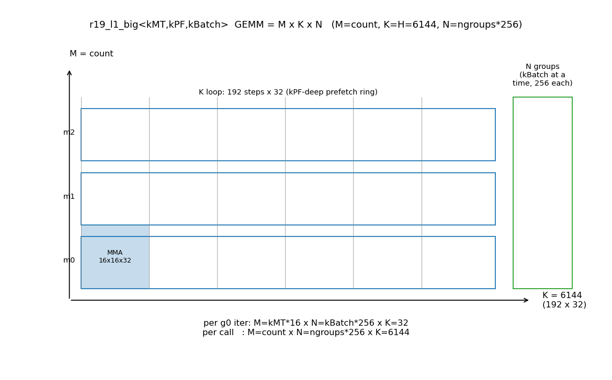
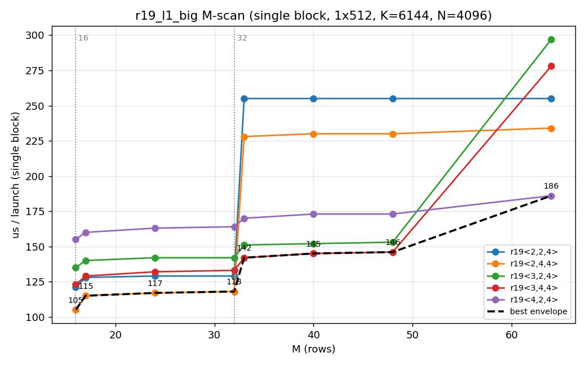
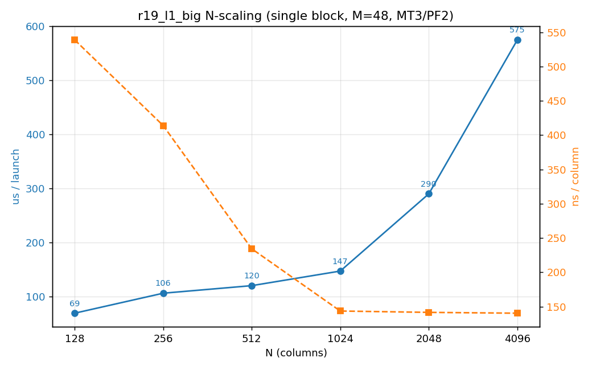

# 17 r19_l1_big 分析（单 block 隔离扫描）

> 对象：`r19_l1_big<kMT,kPF,kBatch>`（`src/compute_big.cuh:345`）——fp8 MoE 的
> **L1 计算**：gate/up 投影（FP8 GEMM）+ SwiGLU + FP8 量化回写。
> 调用者：`r19_small_task`（count≤16 热路径）与 `r19_big_task`（17..48 档及回退）。
> 测例：`test/92.r19_l1_bench`（单 block 隔离，本文件图由 `test/92.r19_l1_bench/plot.py` 生成）。
> 基线：`main` @ `6957f7f`。



---

## 1. 一次处理多少 m / k / n

`r19_l1_big` 计算的是 `C[M,N] = A[M,K] · B[K,N]`，其中：

| 维度 | 取值 | 含义 |
|---|---|---|
| **M** | `count`（≤ win_cap） | 本窗口 token 行数 |
| **K** | `k_hidden = H = 6144` | 单专家输入维（192 个 k-step × 32） |
| **N** | `n_group_count × block_n` | 输出列（=2I 的一段；生产 block_n=256） |

分三层切分（见上图）：

| 粒度 | M | N | K |
|---|---|---|---|
| MMA 基本块 | 16 | 16 | 32 |
| 每次 `g0` 迭代（kBatch 个 N 组） | `kMT×16` | `kBatch×256` | 32 |
| 每次调用（全 c0 / 全 N 组） | `count` | `n_group_count×256` | 6144 |

**关键几何约束**：N 以「组」为单位，每组 `block_n=256`；且 SwiGLU 的 gate/up 配对
要求一次至少 2 组 → **当前实现单次最小 N = 512**。N=128 不能直接跑（需把组宽降到
64 / `nwarps=2`）。

生产均衡口径（`g_l1=4`）：单次调用 **M=count、N=4×256=1024、K=6144**；整层 N=2I=4096
被 4 个 slice 各分 1024，每 block 一份。

---

## 2. 单 block 隔离扫描（口径）

`test/92.r19_l1_bench`：1 block × 512 线程（8 warp）、grid=1、A 走 fragment、
K=6144、N=4096、block_n=256；每次采样 5 次预热 + 冲刷 64MB 缓存后 REP=100 取均值。

> 单 block 下带宽仅 ~40GB/s（≪ HBM），说明此时是**访存延迟受限**，MMA 被权重装载掩盖
> ——这正是"隔离"能暴露的瓶颈（融合核 32 block 时转为带宽受限）。

---

## 3. M 扫描：模板档选择



| M | 2,2,4 | 2,4,4 | 2,8,4 | 3,2,4 | 3,4,4 | 4,2,4 | 4,4,4 |
--:|---:|---:|---:|---:|---:|---:|---:|
| 16 | 121 | **105** | 128 | 135 | 123 | 155 | 184 |
| 24 | 129 | **117** | 143 | 141 | 132 | 163 | 192 |
| 32 | 129 | **118** | 144 | 142 | 133 | 164 | 193 |
| 40 | 255 | 230 | 272 | 152 | **145** | 173 | 205 |
| 48 | 255 | 230 | 273 | 153 | **146** | 173 | 206 |
| 64 | 255 | 234 | 277 | 297 | 278 | **186** | 220 |

- 最优 `kMT = ceil(M/16)`：M≤32→MT2、33..48→MT3、64→MT4。MT 小于需要数会多跑
  c0 迭代（M=48 用 MT2 → 255µs）；MT 大于需要数会空转掩码 tile。
- **`kPF=4` 对 MT2/MT3 有利**（M32：118 vs 129，−9%；M48：146 vs 153，−5%）；
  但 **MT4 要 `kPF=2`**（M64：186 vs 220，PF4 更差，寄存器压力）。
- M≤16 只有 1 个 tile；`<1,*>`（生产热路径档）在本扫描里明显更慢，属寄存器/调度
  优化的两难（见 §5）。

---

## 4. N 缩放：N 变小时会发生什么



| N | 几何 | us | ns/列 |
--:|---|---:|---:|
| 128 | 组宽64×2, nw2 | 69 | 540 |
| 256 | 组宽128×2, nw4 | 106 | 414 |
| 512 | 组宽256×2, nw8 | 120 | 234 |
| 1024 | 组宽256×4, nw8 | 147 | 144 |
| 2048 | 组宽256×8, nw8 | 290 | 142 |
| 4096 | 组宽256×16, nw8 | 575 | 140 |

- 延迟随 N **近似线性**增长（大 N 段 1024→2048→4096 每 +N 的增量恒定）。
- **单位列成本随 N 下降并饱和**在 ~0.14 µs/列（N≥1024）；**N=128 时单位成本 ~3.8×**
  （0.54 vs 0.14）——小 N 下 K=6144 的循环/固定开销占主导，且组宽只能 64（仅 2 warp），
  并行度/MLP 都低。
- 所以若模型 L1 的 N 就是 128：单次调用更快（147→69，−53%），但**单位效率更差**；
  应尽量把多个小 N 合并批量处理以摊薄固定开销。

---

## 5. 独立优化尝试与端到端结论

| 优化 | 单 block | 融合核 `mybench -s1` |
|---|---|---|
| `R19_BPTR`（B 基址预计算，省每步 IMAD） | MT2/3 中配置 −3~5% | 中性偏负（TPR48 +4~5%） |
| `R19_L1_PF=4`（深预取） | MT2/3 −5~9% | **寄存器溢出 → kernel 启动失败(error700)** |

**结论**：单 block 最优（`MT=ceil(M/16)` + `PF4` + `BPTR`，M32 −13%、M48 −10%）**不能
迁移到融合核**——深预取/额外基址寄存器把每线程寄存器顶爆。与 `docs/12 §8`、
`perf.md:640` 一致：隔离微基准不能预测真实混合负载。若要真正用上，前提是把 r19 拆成
**独立 kernel launch**，独占寄存器预算（L1/L2 拆分在 `perf.md` 已实测净回退，需另做取舍）。

---

## 6. 复现

```bash
cd test/92.r19_l1_bench
./build.sh && ./run.sh            # M 扫描 + N 缩放（持 GPU 锁，<10s）
TAG=$(date +%y%m%d_%H%M) python3 plot.py   # 重新生成 docs/figures 图
```
