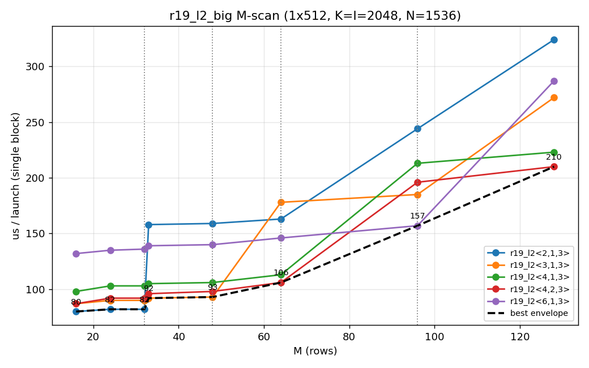
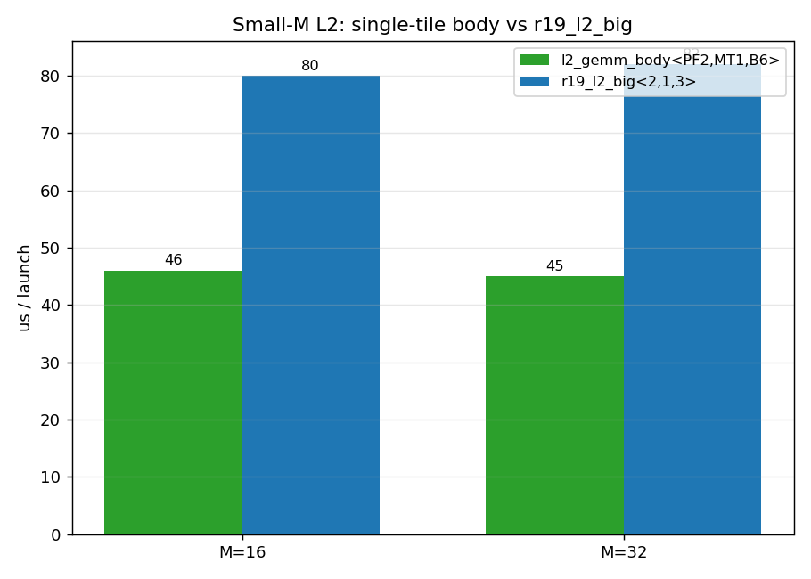
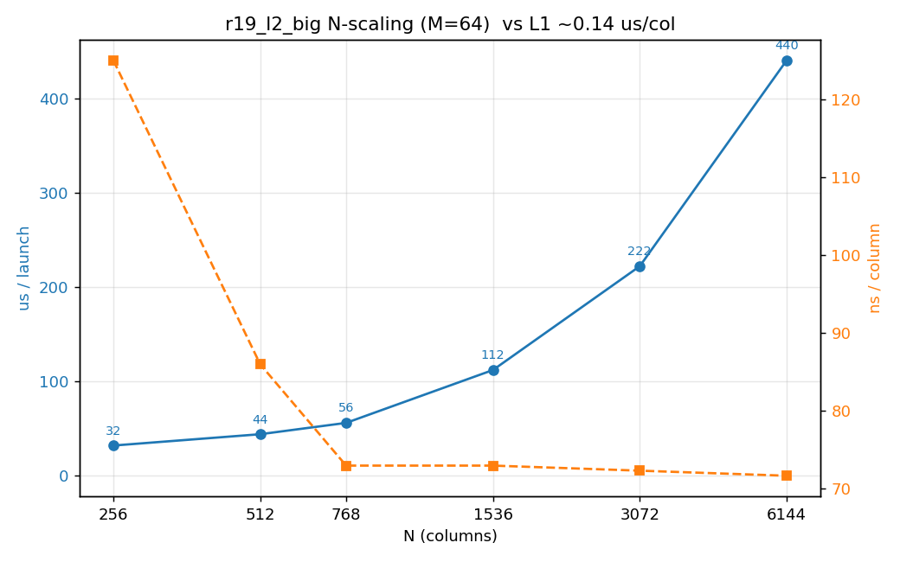

# 18 r19 L2 场景分析（单 block 隔离）

> 对象：`r19_l2_big` / `r19_l2_tile`（`src/compute_big.cuh:796/700`）与 `l2_gemm_body`
> （`src/compute.cuh:535`）——MoE 的 **L2（下投影）** 计算：
> `C[M,H] = A[M,I] · W2[I,H]`，BF16 输出，**无 SwiGLU**。
> 测例：`test/93.r19_l2_bench`；图由 `test/93.r19_l2_bench/plot.py` 生成。
> 基线：`main` @ `6957f7f`（口径同 test/92：单 block 1×512、冷缓存 ×100）。

---

## 1. L2 与 L1 的关键差异

| 维度 | L1（gate/up） | **L2（down）** |
|---|---|---|
| 公式 | C[M,2I]=A[M,H]·W1 | C[M,H]=A[M,I]·W2 |
| **K** | H=6144（192 步） | **I=2048（64 步）** |
| **N** | 2I=4096（每 block 4 组=1024） | **H=6144（每 block `g_l2` 组）** |
| 输出 | FP8 + SwiGLU 量化 | **BF16**（只 pack） |
| 每 block 权重字节 | 1024×6144 | 1536×2048（prod `g_l2=6`） |

L2 的 K 只有 L1 的 1/3、且无 SwiGLU → **单位列成本约为 L1 的一半**（见 §5）。

几何：`M=count`、`K=k_in=I=2048`、`N=n_group_count×256`；MMA 仍 16×16×32；
生产 `g_l2=(H/256)/nslice_eff=(6144/256)/4=6` → 每 block **N=1536**。
（r19_l2_big 对余数组支持 kBatch=2/1 收尾。）

---

## 2. M 扫描：模板档与阶梯



| M | 2,1,3 | 3,1,3 | 4,1,3 | 4,2,3 | 6,1,3 |
--:|---:|---:|---:|---:|---:|
| 16 | 80 | 87 | 98 | 87 | 132 |
| 32 | 82 | 90 | 103 | 92 | **136** |
| 33 | **158** | 92 | 105 | 96 | 139 |
| 48 | 159 | **93** | 106 | 98 | 140 |
| 64 | 163 | 178 | 113 | **106** | 146 |
| 96 | 244 | 185 | 213 | 196 | **157** |
| 128 | 324 | 272 | 223 | **210** | 287 |

- **同样的 `kMT×16` 阶梯**（§17 §3.1）：`<2,*>` M>32 翻倍、`<3,*>` M>48 翻倍。
  最优仍 `kMT=ceil(M/16)`（≤32→MT2、≤48→MT3、≤64→MT4、≤96→MT6）。
- `<6,1,6>`（kBatch=6）**极差**（M=16 就 704µs）：`acc=kBatch*kMT*kNT*4`
  = 6·6·2·4 = **288 floats** → 严重溢出。**kBatch 不宜超过 ~3**。
- `<4,2,3>` 在 M=64 优于 `<4,1,3>`（106 vs 113）：小 K（64 步）下 PF2 略好。

### 2.1 小 M：`l2_gemm_body`（单 tile + 全组批）远快于 `r19_l2_big<2,1,3>`



| M | l2_gemm_body<2,1,6> | r19_l2_big<1,1,6> | r19_l2_big<2,1,3> | r19_l2_big<1,1,3> |
--:|---:|---:|---:|---:|
| 16 | **46** | **47** | 80 | 73 |
| 32 | 46* | 92 | 82 | 144 |

> *`l2_body<...,kMTiles=1>` 只处理 1 个 M-tile（16 行）；M=32 时它没算满，故该格不可比。

**结论（重要）**：`l2_gemm_body` 并不"天生"比 `r19_l2_big` 快——**给相同 tiling
二者等价**（M=16：`r19_l2<1,1,6>`=47 ≈ `l2_body<2,1,6>`=46）。差异全在 **(kMT,kBatch) 选择**：

- 小 M 应 **kMT=1**（不浪费 tile）且 **kBatch=全部组**（A 只装载一遍）。
  生产 `count≤32` 用的正是 `l2_gemm_body<…,MT2,B6>` 这类单趟配置。
- `r19_l2_big<2,1,3>` 在 M=16 时 **kMT=2 白跑一个空 tile**，且 **kBatch=3 → 2 个 g0 趟**
  （A 被重读、多一倍循环开销）→ 80 vs 47（~1.7×）。
- 所以"单位性能更好"是**调度/分档**的功劳，函数本体无优劣。

**为什么 L1 不用（等价的单 tile body）？** L1 的等价物是
`l1_gemm_swiglu_body_paired`（`compute.cuh:329`）。它确实在部分隔离微基准里更优
（`test/80`：M=17..32 frag ~103~106µs），但生产已改为 `r19_l1_big`，原因：
1. **寄存器**：paired 的 PF 预取环（PF4）在融合任务体里抬高寄存器、拖慢其它档
   （`perf.md` 929a9c7：小档由 `paired<4,…>` 改 `r19<1,2,2>`）；
2. **更大的 M-tile 权重复用**：`r19_l1_big` 支持 MT4/MT8（paired 只到 MT2/3），
   权重读遍数减半（`perf.md` ed286a9：17..32 由 `paired<2>` 改 `r19<4,2,4>`）；
3. 统一分档 + fragment A 装载 + 尾组递归收尾。
   > 教训见 `docs/12 §8`：隔离微基准不能预测混合负载最优。
   L2 之所以保留 `l2_gemm_body`：它更轻（无 SwiGLU/FP8 量化，寄存器少）、小档
   tiling（MT2/B6）本就合适；L2 的大档另走 `r24_l2_big`。

---

## 3. N 缩放



| N | 组数 | us | ns/列 |
--:|---:|---:|---:|
| 256 | 1 | 32 | 125 |
| 512 | 2 | 44 | 86 |
| 768 | 3 | 56 | 73 |
| 1536 | 6 | 112 | 73 |
| 3072 | 12 | 222 | 72 |
| 6144 | 24 | 440 | 72 |

- N≥768 后**单位列成本饱和 ~72ns/列**；N=1536→3072→6144 严格线性（×2 / ×2）。
- 对比 L1 ~140ns/列：**L2 单位效率约 2×**（K 只有 1/3、且无 SwiGLU/FP8 量化）。
- N=256 时 125ns/列（固定开销占比高）——与 L1 同规律：小 N 摊不薄固定成本。

---

## 4. 优化空间（L2）

1. **小 M（≤32）用单 tile `l2_gemm_body`**：比 `r19_l2_big` 快 ~1.7×（生产已如此）。
2. **kBatch ≤ 3**：kBatch=6 的 acc 达 288 floats → 溢出（实测 704µs）。
3. **kMT = ceil(M/16)** 避免多跑 c0 趟；`<4,2,3>` 于 M=64 小幅胜 `<4,1,3>`。
4. **M>64**：生产用 `r24_l2_big`（A-smem 异步），隔离测量下 r24 系在大 M 优于 r19；
   r19_l2 主要覆盖 ≤64 档与回退。
5. 与 L1 同结构限制：寄存器预算（acc 128 顶格）与权重装载延迟是天花板；
   函数内微优化（B 基址预计算等）收益与 L1 同量级（个位数 %）。

---

## 4.1 `l2_gemm_body` 微优化实测

**单 block（MT=ceil(M/16)、kBatch=6、冷缓存×100，us）**：

| M | PF1 | PF2 | PF4 | PF8 |
--:|---:|---:|---:|---:|
| 16 | 46 | 46 | 48 | 97 |
| 32 | 75 | 77 | 80 | 238 |
| 48 | **86** | 111 | 341 | 643 |

- PF1 ≥ PF2；MT3 时 PF2 因 `a_pipe/b_pair` ring + `acc[6][3][2]=144` 溢出，慢 **29%**。
- PF4/PF8 ring 更大 → 严重溢出。`CM_BPTR_L2=1` 中性（与 L1 的 `R19_BPTR` 不同）。

**端到端 `mybench -s1`（3 次均值，`CM_L2_PF` 2→1）**：

| TPR | base | PF1 | Δ |
--:|---:|---:|---:|
| 16 | 394 | 378 | −4.1% |
| 24 | 499 | 479 | −3.9% |
| 32 | 506 | 479 | **−5.4%** |
| 48 | 549 | 570 | +3.9% |
| 64 | 638 | 643 | +0.8% |

- `CM_L2_PF` 参与整个 `r19_big_task` 的寄存器分配，**改一个档会重排全局**：
  ≤32 受益（−4~5%），48 反受 +4%。属"寄存器重排"级杠杆，非干净收益。
- 若按档选 PF（≤32 用 PF1、48 用 PF2）可只取收益、回避回退（待做）。

**其它**：`CM_BPTR_L2=1` 中性；去 `acc_chk` 校验和 ~2%（需 check 双路）；
PF4/PF8/更大 kBatch 均更差。函数本体结构性空间已尽（A 走 fragment、B 直装、
acc 触顶、K=64 短流水）。

---

## 5. 复现

```bash
cd test/93.r19_l2_bench
./build.sh && ./run.sh                         # M 扫描 + 小M对照 + N 缩放（持锁 <10s）
TAG=$(date +%y%m%d_%H%M) python3 plot.py       # 重新生成 docs/figures 图
```
