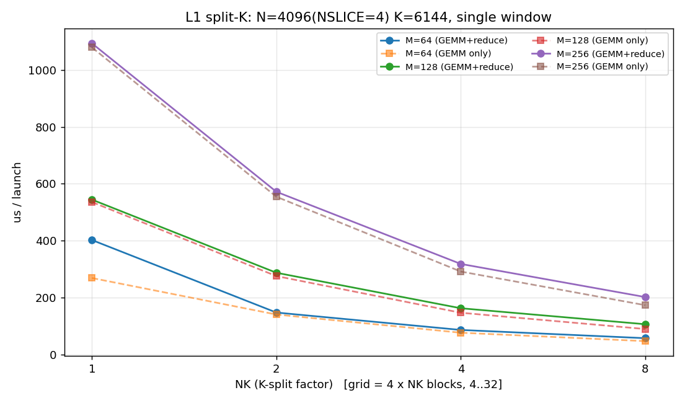
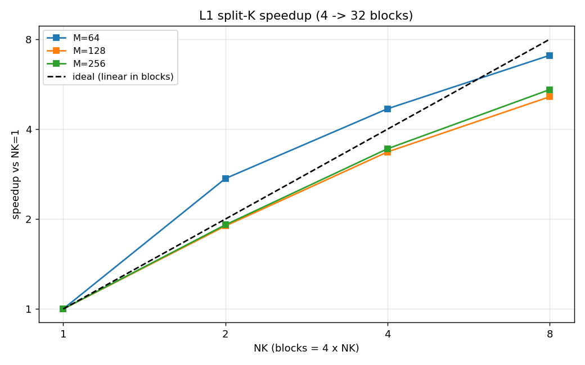

# 19 L1 K 维切分（split-K）性能分析

> 动机：rank 内本地专家负载不均衡 → 部分 block 早做完空转。
> N 切分受 `nslice=4` 甜点限制、M 切分会重复读权重，**只有 K 切分不重复 A/权重**，
> 代价仅是 FP32 部分和归约。本测例验证 K 切分的加速与开销。
> 测例：`test/94.r19_ksplit_bench`；图由 `test/94.r19_ksplit_bench/plot.py` 生成。





## 1. kernel 设计

- L1：`C[M,2I] = A[M,H] · W1[H,2I]`，**K=H=6144、N=2I=4096**。
- **N 切 `NSLICE=4`**（每片 1024 = 4 组×256，与生产 nslice=4 一致）；
  **K 切 `NK∈{1,2,4,8}`** 片。
- `grid = (4, NK)` → block 数 **4/8/16/32**；每个 block 算一个 `(nslice, kchunk)`
  的 **FP32 部分和**（MMA `16×16×32` + 寄存器预取环），写入 `partial[NK][M][2I]`。
- `k_reduce`：对每个输出 `(m, hidden p)` 累加 NK 份 `gate/up` → **SwiGLU → 量化**。
- 计时含 **GEMM 部分和 + 归约**；另测"仅 GEMM 部分和"以隔离归约开销。

## 2. 结果（单窗口，us/launch）

**含归约（完整）**：

| M | NK=1 | NK=2 | NK=4 | NK=8 |
--:|---:|---:|---:|---:|
| 64 | 402 | 147 | 86 | 57 |
| 128 | 544 | 287 | 162 | 106 |
| 256 | 1094 | 572 | 318 | 202 |

**仅 GEMM 部分和**：

| M | NK=1 | NK=2 | NK=4 | NK=8 |
--:|---:|---:|---:|---:|
| 64 | 269 | 140 | 76 | 47 |
| 128 | 536 | 275 | 146 | 89 |
| 256 | 1080 | 555 | 291 | 173 |

**归约开销 = 完整 − 仅 GEMM**：M=256 时 14/17/27/29µs（NK=1/2/4/8），
即 NK=8 占 **~14%**；随 NK 线性增长（读 `NK×M×2I×4B` 部分和）。

## 3. 分析

1. **近线性加速**：block 数 4→32，GEMM-only 加速 M=256 **6.2×**、M=128 6.0×、
   M=64 5.8×（<8×，因单 block 在少 block 时更接近吞吐上限）。完整（含归约）加速
   M=256 **5.4×**。
2. **K 切分流量中性**：A 各 block 读自己 `A[:, k片]`、权重各读自己 `W1[k片, :]`，
   **总字节不变**；只多出 FP32 部分和的写/读（`NK×M×2I×4B`）。
3. **归约代价可控**：~10~14%（NK=8），因为部分和只有输出大小（不是 A/权重）。
4. **与切 N/M 对比**：N 切 ×nslice 重复读 A、M 切 ×份数重复读权重——**K 切是唯一
   不放大访存的维度**，这也是它能做负载均衡的前提。

## 4. 结论 / 适用边界

- **单窗口 K 切分有效且开销可控**：可作为"**尾部救援**"——把最重窗口剩余的 K 片
  交给空闲 SM，归约代价 ~10~15%。
- **判据**：只有当"尾部空转时间 > 归约开销"时才净赚。忙时（32 SM 满、权重带宽已近峰值
  `perf.md:447`）K 切分不省带宽，只增加部分和流量。
- **注意耦合**：与 `nslice` 叠加时，一个窗口的 4 个 N 片仍需 wait-all 才能进 L2；
  K 切分应作用在**窗口内部**（同一窗口的 K 段），不要引入新的跨窗口同步。
- **落地形态**：动态调度里，当某 block 领到重窗口且全局队列将空时，才派生 K 子任务，
  `atomicAdd` 到 FP32 累加缓冲，最后一个小 pass 做 SwiGLU+量化。

## 5. 复现

```bash
cd test/94.r19_ksplit_bench
./build.sh && ./run.sh                              # 出两张表（持 GPU 锁，<10s）
TAG=$(date +%y%m%d_%H%M) python3 plot.py            # 生成 docs/figures 图
```
